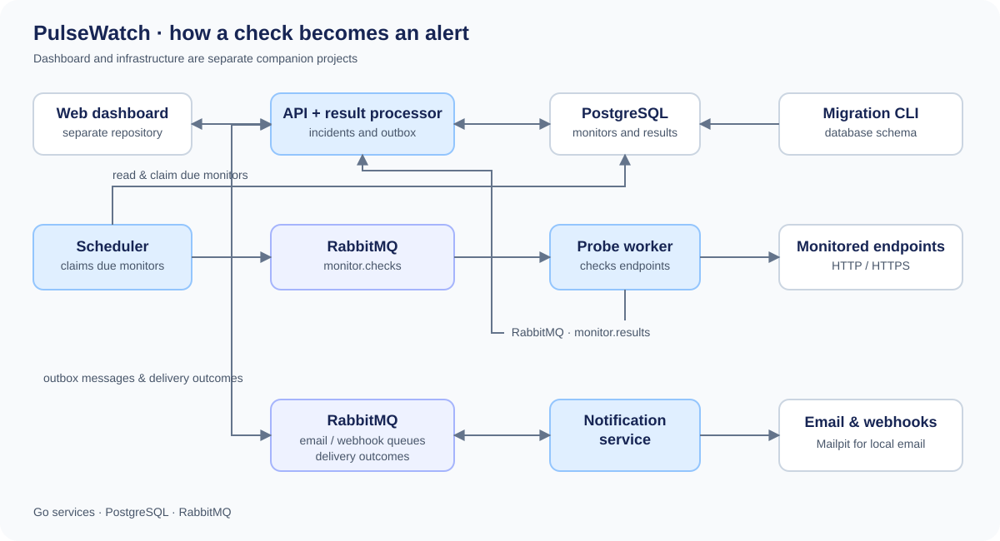

# PulseWatch

PulseWatch monitors HTTP endpoints, records uptime and response times, and sends email or webhook alerts when incidents occur. This repository contains the Go backend and database migrations.



## Get started

With Docker and Docker Compose installed:

```bash
cp .env.example .env
docker compose up --build
```

The API is available at [localhost:8080/health](http://localhost:8080/health). The [web dashboard](https://github.com/paranietharan/pulse-watch-web) is maintained separately.

## Recovery tests

The PostgreSQL tests open and resolve an incident, replay a heartbeat, and check that exactly two notification intents survive. Publisher and notification tests verify retry identity and suppression of completed deliveries. [Passing recovery suite](https://github.com/paranietharan/pulsewatch/actions/runs/44538129186)

## Documentation

- [Getting started and local development](docs/getting-started.md)
- [Architecture and services](docs/architecture.md)
- [API endpoints](docs/api.md)
- [Configuration](docs/configuration.md)
- [Infrastructure and deployment](https://github.com/paranietharan/pulsewatch-infra)
