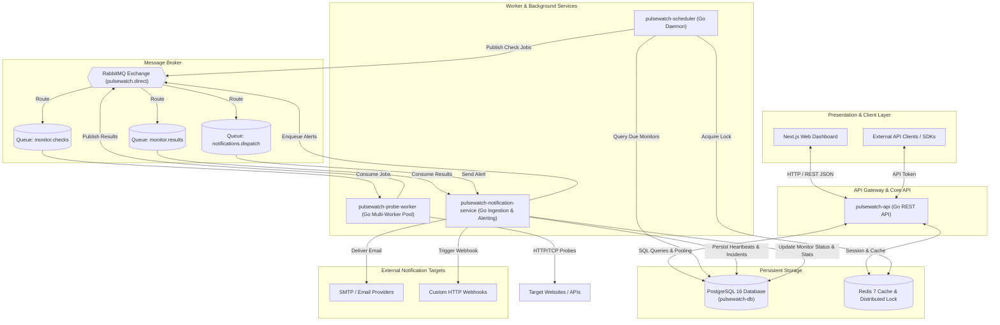
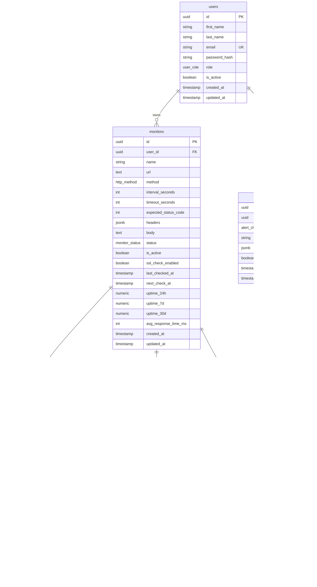
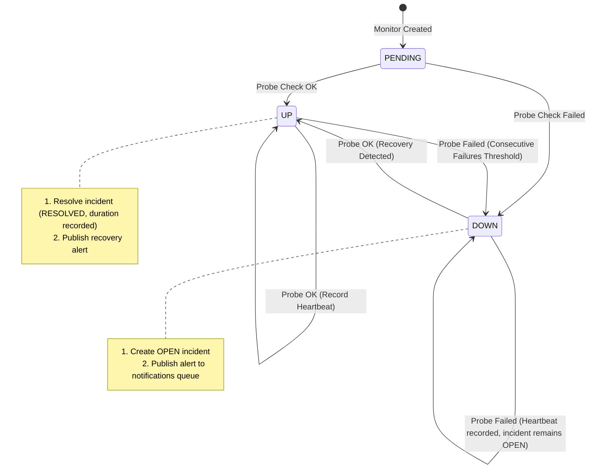

# Context — PulseWatch Uptime Monitoring Platform

PulseWatch is a distributed, production-grade uptime and performance monitoring system engineered for high availability, low latency, and horizontal scalability. This document details the architectural topology, data model, communication contracts, service responsibilities, and operational mechanics of the platform.

---

## 1. System Topology & Architectural Overview

The platform separates ingestion, scheduling, execution, persistence, and presentation into decoupled microservices communicating via **PostgreSQL** and **RabbitMQ**:



---

## 2. Microservice Breakdown & Responsibilities

### 2.1 `pulsewatch-api` (Go REST API)
- **Role**: Serves the REST API for both the frontend dashboard and programmatic consumers.
- **Key Responsibilities**:
  - User authentication and authorization (JWT tokens, password hashing via bcrypt).
  - CRUD operations for monitors (URLs, intervals, timeouts, headers, HTTP methods).
  - Configuration of notification channels (Email, Webhook, Slack, PagerDuty).
  - Incident querying, acknowledging, and manual resolution.
  - Querying historical performance metrics (24h/7d/30d uptime %, latency percentiles).

### 2.2 `pulsewatch-scheduler` (Go Daemon)
- **Role**: Continuously evaluates monitors that are due for health checks and dispatches probe tasks.
- **Key Responsibilities**:
  - Queries active monitors where `next_check_at <= NOW()`.
  - Employs Redis distributed locks (`SET key val NX EX`) to avoid duplicate dispatch when running multiple scheduler replicas.
  - Computes and updates `next_check_at = NOW() + interval_seconds`.
  - Publishes check payloads to RabbitMQ `monitor.checks` queue.

### 2.3 `pulsewatch-probe-worker` (Go Probe Worker)
- **Role**: Stateless, concurrently scalable workers that execute actual network checks against target endpoints.
- **Key Responsibilities**:
  - Consumes probe check messages from `monitor.checks`.
  - Executes HTTP/HTTPS and TCP checks using configurable timeouts.
  - Measures detailed latency metrics:
    - DNS Lookup time
    - TCP Connect time
    - TLS Handshake time
    - Total response time
  - Inspects SSL/TLS certificates (validity, issuer, expiration timestamp).
  - Performs SSRF sanitization (blocks probes to private IP subnets: `127.0.0.0/8`, `10.0.0.0/8`, `192.168.0.0/16`, `172.16.0.0/12`, AWS metadata `169.254.169.254`).
  - Publishes structured check results to `monitor.results`.

### 2.4 `pulsewatch-notification-service` (Go Result Ingestion & Alerting)
- **Role**: Ingests probe execution results, manages incident lifecycle states, and dispatches notifications.
- **Key Responsibilities**:
  - Consumes execution results from `monitor.results`.
  - Persists check data into the `heartbeats` table in PostgreSQL.
  - Detects state transitions:
    - **`UP -> DOWN`**: Creates a new record in `incidents` (`status: OPEN`) and triggers failure alerts.
    - **`DOWN -> UP`**: Updates active incident (`status: RESOLVED`, calculates downtime duration) and triggers recovery alerts.
  - Implements notification throttling and flapping suppression (prevents alert fatigue if an endpoint rapidly flips between up and down).
  - Dispatches email alerts (SMTP) and HTTP webhooks with exponential backoff on delivery failure.

### 2.5 `pulse-watch-db` (PostgreSQL Database & Migration Tooling)
- **Role**: Houses PostgreSQL database schemas and the automated Go migration runner (`main.go`) built with `golang-migrate`.
- **Key Responsibilities**:
  - Manages sequential schema versioning in `pulse-watch-db/migrations/`.
  - Tracks migration executions in `schema_migrations` with automatic dirty-state tracking.
  - Supports non-destructive forward migrations (`up`) and automated rollbacks (`down`).

---

## 3. Database Schema & Entity Relationships



---

## 4. Message Queue (RabbitMQ) JSON Contracts

### 4.1 Probe Job Dispatch (`monitor.checks`)
Published by `pulsewatch-scheduler`, consumed by `pulsewatch-probe-worker`:
```json
{
  "job_id": "9b1deb4d-3b7d-4bad-9bdd-2b0d7b3dcb6d",
  "monitor_id": "7c9e6679-7425-40de-944b-e07fc1f90ae7",
  "url": "https://api.example.com/health",
  "method": "GET",
  "timeout_seconds": 10,
  "expected_status_code": 200,
  "headers": {
    "User-Agent": "PulseWatch-Probe/1.0"
  },
  "body": null,
  "ssl_check_enabled": true,
  "scheduled_at": "2026-10-10T10:45:00Z"
}
```

### 4.2 Probe Result Reporting (`monitor.results`)
Published by `pulsewatch-probe-worker`, consumed by `pulsewatch-notification-service`:
```json
{
  "job_id": "9b1deb4d-3b7d-4bad-9bdd-2b0d7b3dcb6d",
  "monitor_id": "7c9e6679-7425-40de-944b-e07fc1f90ae7",
  "status": "UP",
  "status_code": 200,
  "response_time_ms": 142,
  "dns_lookup_ms": 18,
  "tcp_connect_ms": 24,
  "tls_handshake_ms": 32,
  "error_message": null,
  "region": "us-east-1",
  "checked_at": "2026-10-10T10:45:01Z"
}
```

### 4.3 Notification Alert Payload (`notifications.dispatch`)
Internal routing to alert handlers:
```json
{
  "alert_id": "d290f1ee-6c54-4b01-90e6-d701748f0851",
  "monitor_id": "7c9e6679-7425-40de-944b-e07fc1f90ae7",
  "monitor_name": "Production API",
  "event_type": "SERVICE_DOWN",
  "status_code": 503,
  "error_message": "Service Unavailable: connection refused",
  "incident_id": "8a32b212-01fe-45ab-bc61-f312891910aa",
  "channels": [
    {
      "type": "email",
      "destination": "devops@example.com"
    },
    {
      "type": "webhook",
      "destination": "https://hooks.slack.com/services/T00/B00/X00"
    }
  ],
  "timestamp": "2026-10-10T10:45:02Z"
}
```

---

## 5. Incident & Status State Machine



---

## 6. Local Development Quickstart

### Step 1: Initialize Configuration
```bash
cp .env.example .env
```

### Step 2: Spin Up Infrastructure
```bash
docker compose up -d postgres
```

### Step 3: Run Database Migrations
```bash
# Check status
go run pulse-watch-db/main.go status

# Apply all migrations
go run pulse-watch-db/main.go up
```

### Step 4: Verify Database Readiness
```bash
go run pulse-watch-db/main.go status
```
Output confirms active migration version (e.g. `version: 6 | Dirty state: false`).
