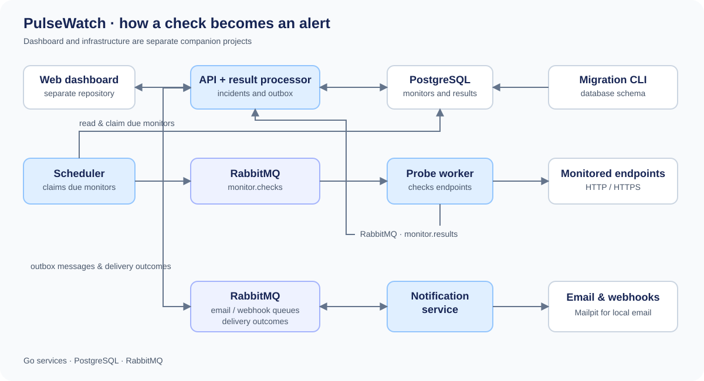

# Architecture

The [web dashboard](https://github.com/paranietharan/pulse-watch-web) talks to the Go API. The API stores configuration and results in PostgreSQL. The migration CLI owns the database schema.

1. The scheduler claims due monitors in PostgreSQL and publishes checks to RabbitMQ.
2. The probe worker consumes checks, probes the configured endpoints, and publishes results.
3. The API consumes results, updates monitor and incident state, and queues notifications through a transactional outbox.
4. The notification service consumes email and webhook messages, sends them, and publishes delivery outcomes for the API to process. Authentication emails also go through the outbox and notification service.

RabbitMQ carries `monitor.checks`, `monitor.results`, `notifications.email`, `notifications.webhook`, and `notifications.delivery_outcome`. Mailpit captures email locally; production deployments can use an SMTP provider.

| Component | Directory | Responsibility |
| --- | --- | --- |
| API and result processor | [pulsewatch-api](../pulsewatch-api) | Authentication, API, results, incidents and outbox |
| Scheduler | [pulsewatch-scheduler](../pulsewatch-scheduler) | Claims due monitors and publishes checks |
| Probe worker | [pulsewatch-probe-worker](../pulsewatch-probe-worker) | Executes checks and publishes results |
| Notification service | [pulsewatch-notification-service](../pulsewatch-notification-service) | Delivers email and webhooks |
| Migration CLI | [pulse-watch-db](../pulse-watch-db) | Manages PostgreSQL migrations |

Deployment configuration is maintained in [pulsewatch-infra](https://github.com/paranietharan/pulsewatch-infra).

Incident transitions and notification intents commit together. Publishers lock one due event until its broker confirmation is recorded. A replay retains its message ID and webhook delivery ID. External delivery is at least once. Apply database migration 009 before starting the API. Scheduling is best effort per interval. A failed publish increments the missed-observation count in the sweep log and the next interval stays scheduled.

The notification service uses DATABASE_URL to record successful message IDs before acknowledging RabbitMQ. A completed receipt suppresses replay across restarts. If an external send succeeds immediately before a database/process failure, replay can send again. Webhooks carry a stable delivery ID for receiver-side deduplication.
